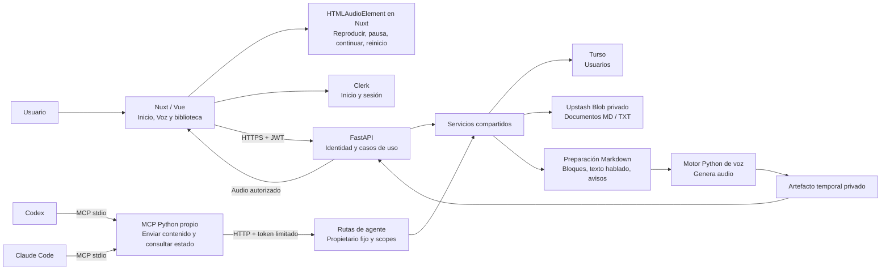

# 01 — Contexto y responsabilidades

Fecha de creación: 2026-10-30
Última actualización: 2026-10-30
Estado: Plan
Relacionada con: [arquitectura](../product/03-arquitectura-y-legibilidad.md), [plan MCP](../plans/04-api-voz-y-mcp.md)

Diagrama objetivo; los servicios y el MCP propio todavía no están implementados.

La UI completa y la reproducción viven en Nuxt. Python genera audio y protege datos; MCP permite integrar agentes sin sustituir los controles del navegador. Los plugins Turso y Upstash de Codex son herramientas de desarrollo distintas del MCP de nuestra aplicación.
