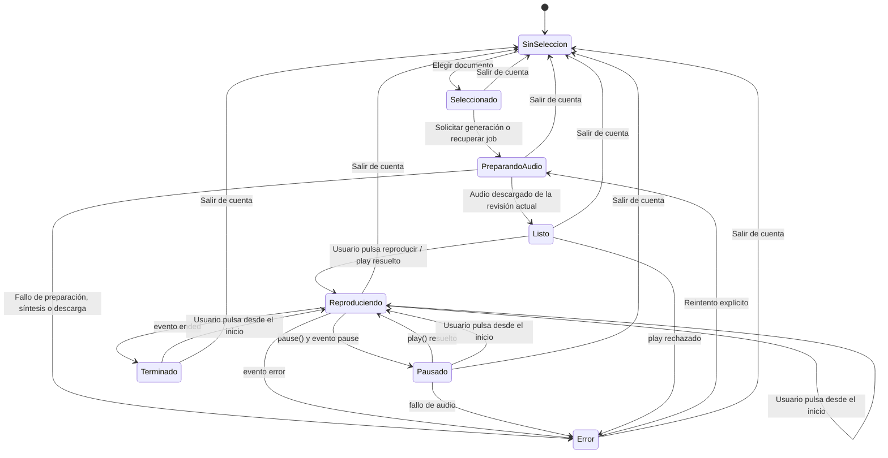

# 03 — Estados del reproductor Nuxt

Fecha de creación: 2026-10-30
Última actualización: 2026-10-30
Estado: Plan
Relacionada con: [plan frontend](../plans/05-frontend-acceso-y-panel-voz.md), [requisitos](../product/02-requisitos-y-recorrido.md)

Estado de interfaz y audio local. Los estados del job de síntesis del backend son independientes: queued/running/ready/failed/expired.

Al cambiar documento desde cualquier estado: detener audio previo, abortar peticiones, invalidar intento y volver a Seleccionado. Al salir: además revocar Object URL y vaciar datos privados. Reiniciar establece tiempo cero del mismo audio; no pide volver a sintetizar. Reflejar eventos reales del elemento y errores de `play()`; no dar por iniciada una reproducción porque el backend haya terminado el job.

Estos controles y toda la pantalla se implementarán en Nuxt/Vue. MCP solo envía documentos y consulta procesamiento.
