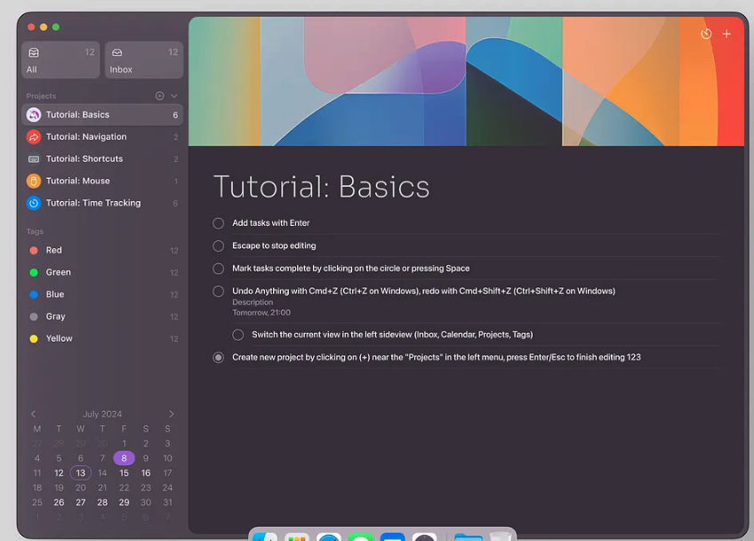

# 06 — Dirección visual Focus, adaptada a Nuxt

Fecha de creación: 2026-10-30
Última actualización: 2026-10-30
Estado: Referencia elegida; diseño pendiente
Relacionada con: [frontend](../plans/05-frontend-acceso-y-panel-voz.md), [requisitos](../product/02-requisitos-y-recorrido.md)

Tipo de fuente: captura del usuario, publicación original y análisis visual propio. Consulta: 2026-10-30.

F1 — [Focus — A macOS App for Seamless Task and Time Management](https://dribbble.com/shots/23933563-Focus-A-macOS-App-for-Seamless-Task-and-Time-Management), Aleksandr Subbotin para youami. No se conoce su código ni framework.

F2 — Captura proporcionada por el usuario, conservada para referencia:

## Observación y adaptación

| Observación de la imagen | Adaptación propia para nuestra web Nuxt |
| --- | --- |
| Barra lateral de aproximadamente una cuarta parte del ancho. | Inicio y Voz, con selección suave; lateral plegable cuando el ancho lo exija. |
| Principal ciruela oscuro y lateral gris violáceo. | Tokens CSS de superficies, texto y selección, con variante clara y contraste comprobado. |
| Cabecera multicolor con curvas superpuestas. | Ilustración SVG/CSS propia, más baja en el lector para dar espacio al texto. |
| Título grande y fino, filas densas y separadores tenues. | Jerarquía clara; cuerpo de lectura con peso y tamaño cómodos, sin grandes tarjetas por documento. |
| Pequeños acentos de color y fondo activo redondeado. | Indicadores discretos y estado expresado también con texto. |

Las proporciones son aproximadas; no se ha identificado familia tipográfica exacta. Evitar copiar sus recursos gráficos como activos de producto. No introducir calendario, proyectos ni botones de tareas por aparecer en la imagen.

La adaptación completa se implementará con componentes Vue, layouts Nuxt, Tailwind/CSS y SVG. La biblioteca, editor, lector y controles visibles viven en Nuxt. No se dibujan semáforos de ventana del sistema dentro del navegador. Se comprobarán foco, teclado, contraste, tamaño de ventana y movimiento reducido.

Estado real: se conserva la base de acceso/cuenta del proyecto copiado; todavía no hay panel Voz inspirado en Focus ni validación visual final. Esta ficha conserva el diseño pedido y su aplicación futura.
